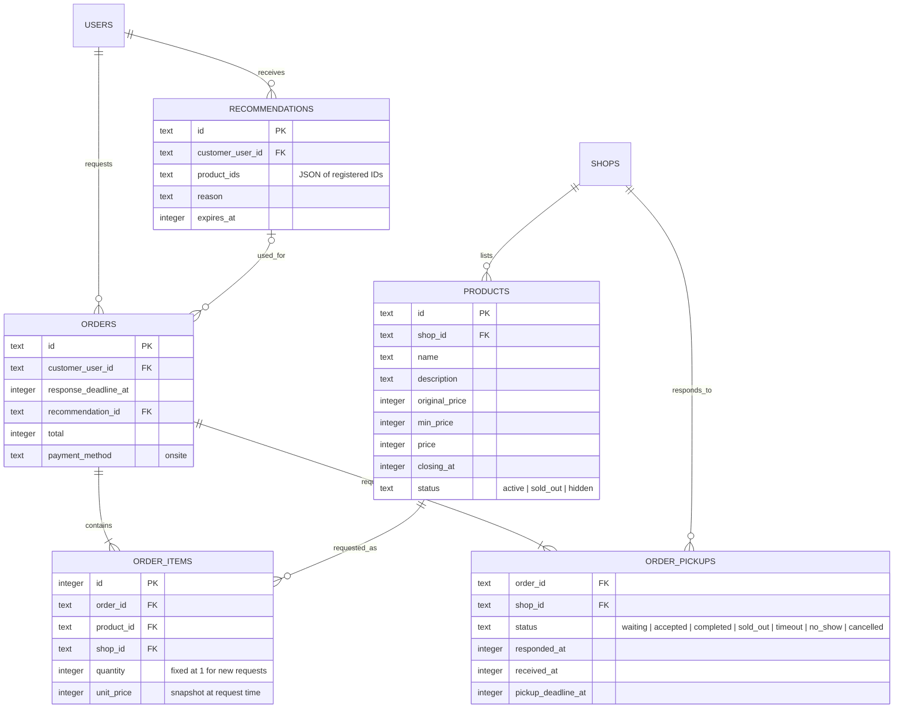

# 데이터 구조

상품에 등록 수량 필드는 없습니다. `ORDER_ITEMS.quantity`는 기존 주문 기록과 호환을 위해 남겨 두며 신규 예약 요청은 항상 1로 저장합니다. 예약 전체 상태는 가게별 `ORDER_PICKUPS.status`에서 계산합니다. `waiting`이 모두 `accepted`가 되면 확정하고, `sold_out` 또는 `timeout`이 발생하면 종료합니다. 픽업 마감 후 미수령은 `no_show`입니다.
