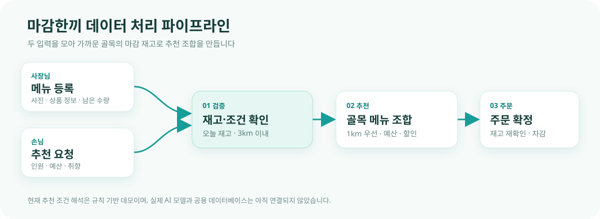

# 마감한끼 추천·재고 데이터 파이프라인



사이트는 `public/recommendation-pipeline.js`를 브라우저에서 실행하고, `app/api/ai/interpret/route.ts`가 GPT로 손님·사장님 문장을 해석합니다. `OPENAI_API_KEY`가 설정되지 않았거나 API가 실패하면 기존 규칙 분석으로 돌아갑니다. 공용 데이터베이스는 아직 없으며, 사장님이 등록·수정한 메뉴와 손님의 주문은 같은 브라우저의 `localStorage`에 저장됩니다.

```text
사장님 사진·음성/텍스트 입력
  → 서버에서 GPT로 상품명·가격·수량·마감시간 초안 추출(실패 시 규칙 분석)
  → 사장님 확인·수정·등록
  → 오늘의 메뉴 재고(localStorage)
  → 손님 AI 추천 요청(인원·예산·취향)
  → ① 서버에서 GPT로 요청 해석, safeIntent로 검증(실패 시 parseIntent)
  → ② 오늘 메뉴 중 재고·가격·가게 위치 검증(prepareInventory)
  → ③ 현재 위치 3km 이내 필터, 1km 이내 우선 순위(rankCandidate)
  → ④ 예산·인원·재고 한도 안에서 조합 생성(assembleSet)
  → ⑤ 골목 응원 할인 계산 및 추천 표시(run)
  → 손님 장바구니·주문 시 재고 재확인 및 차감
```

## 단계별 입출력

| 단계 | 입력 | 출력 및 검사 |
| --- | --- | --- |
| 등록 | 사장님 사진, 상품 정보 | 상품 초안. 사장님이 확인해야 등록되며 상품 설명이 비면 “마감 상품을 판매합니다” 저장 |
| 요청 해석 | 손님 문장, GPT가 추출한 조건 | 인원, 예산, 커피 제외, 식사·디저트 선호. 문장에 명시된 인원·예산·커피 제외는 AI 추출값이 덮어쓸 수 없음 |
| 재고 후보 | 오늘 메뉴, 가게 좌표, 손님 기준 위치 | 양수 가격·재고, 유효한 가게, 3km 이내 메뉴만 통과 |
| 우선 순위 | 검증된 후보, 선호 | 1km 이내 가게, 음식 종류, 거리, 소량 재고를 반영한 정렬 |
| 조합·가격 | 후보, 인원, 예산, 재고량 | 재고 이하 수량으로 조합. 개별 할인가 합계가 예산 이내인 메뉴만 담고 골목 응원 할인 계산 |
| 주문 | 추천 조합 또는 장바구니 | 주문 직전에 재고를 다시 확인한 뒤 차감하고 주문 내역·픽업 순서 생성 |

## 실제 운영으로 옮길 때

1. PostgreSQL에 `shops`, `menus`, `inventory_movements`, `orders`, `order_items`를 저장하고 메뉴에 가게 위치, 마감시각, 상태를 연결합니다. PostGIS로 반경 3km 후보를 조회합니다.
2. 사장님이 초안을 승인할 때 서버에서 가격·수량·사진을 검증하고 재고 변경 기록을 남깁니다. 현재는 GPT가 설명 문장만 해석하고 사진은 보내지 않으며, 점주가 초안을 다시 확인합니다.
3. 추천 문장을 GPT가 해석하더라도 `safeIntent`로 형식을 검증합니다. 추천 후보는 서버에서 최신 재고와 위치로 다시 조회해야 합니다. API 키는 브라우저에 넣지 않습니다.
4. 주문 생성과 재고 차감은 데이터베이스 트랜잭션으로 처리합니다. 품절·마감 상품은 실패 응답과 함께 추천 조합을 다시 계산합니다.
5. 추천 요청 수, 후보 부족률, 주문 전환율, 품절 충돌, 마감 재고 소진율을 기록합니다. 위치 정보는 사용자 동의 범위에서만 사용합니다.

현재 시연에서는 메뉴의 `date`로 오늘 등록분을 고르지만 마감시각이 지난 상품을 서버에서 차단하지 않습니다. 실제 주문 서비스에서는 서버 시각을 기준으로 마감 여부를 확인해야 합니다. 브라우저 저장소만 사용하므로 기기 간 재고 동기화와 동시 주문 보호도 아직 없습니다.
